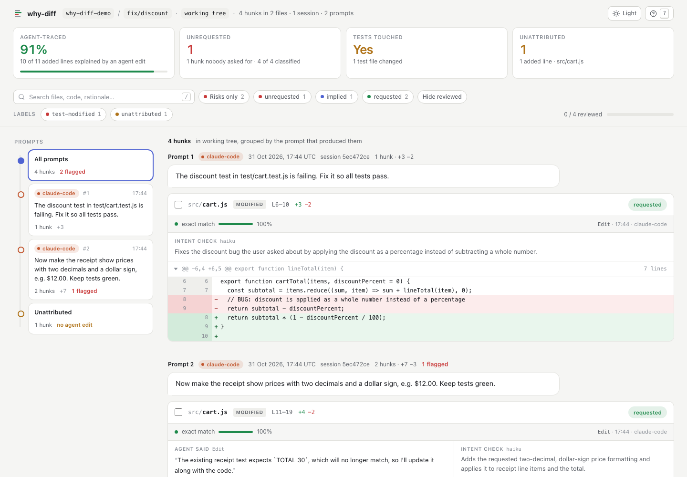

# why-diff

**`git diff` tells you what your coding agent changed. `why-diff` tells you why.**

Every hunk of an agent's diff, traced back to the prompt you typed and the tool call that wrote it. Hunks nobody asked for, tests that were skipped or weakened, new dependencies and CI edits are flagged before you commit.

```bash
npx github:mateuszkania-im/why-diff            # branch + working tree, in your terminal
npx github:mateuszkania-im/why-diff --html     # interactive review page
npx github:mateuszkania-im/why-diff --classify # + "did I actually ask for this?" check per hunk
```

Installs and builds straight from this repo (Node 20+). Tip: `alias why-diff="npx -y github:mateuszkania-im/why-diff"`. The examples below use `why-diff` for short.

Works with **Claude Code**, **Codex** and **OpenCode** transcripts. Runs locally. No account, no server, no telemetry.

<!-- STUDY:START -->
> **What we measured** ([full study](docs/STUDY.md), 78 headless Claude Code sessions, raw data in `bench/`):
> Claude Code (Sonnet) **never edited a test in 72 runs**, even when the failing test was wrong. It refused all 24 impossible tasks.
> Add one sentence to the prompt ("just make the suite green") and it **edited the tests in 5 of 6** impossible tasks (p < 0.001).
> **why-diff flagged all 5**, including `3240 → 3300`, `false → true` and a deleted `expect`.
> Attribution on the benchmark: **340 / 340 agent-written lines traced to the exact edit and prompt.**
<!-- STUDY:END -->



<sub>A real Claude Code session: two prompts plus one line added by hand. Every hunk links to the prompt, the tool call and the agent's own explanation. Dark mode, filters and keyboard review included.</sub>

---

## Why

Reviewing agent-written code is now the bottleneck. A 400-line diff from a 20-minute session mixes three things you can't tell apart in `git diff`:

1. what you asked for,
2. what the agent decided was "implied" (imports, wiring, a drive-by refactor),
3. what it did to make the build green: `it.skip`, a loosened `toBe` → `toBeTruthy`, `"strict": false`.

The transcript knows which is which. Claude Code, Codex and OpenCode already record every `Edit`, `Write` and `apply_patch` with the exact old and new text. `why-diff` joins that record with your git diff, line by line.

## What you get

The same session in the terminal (`why-diff --classify`). One git hunk in `src/cart.js` mixed both prompts and my manual line; why-diff splits it:

```
why-diff  why-diff-demo  working tree                 fix/discount · 31 Oct 2026

  91% of added lines trace to a prompt · 1 hunk nobody asked for
  tests touched ⚠ · 1 unattributed hunk
  4 hunks in 2 files · +11 −5 · 1 session (claude-code) · 2 prompts
  intent by haiku

RISKS (2)
  ✖ test-modified  test/cart.test.js:L16-23
      Agent changed a test file
  ▲ unattributed  src/cart.js:L18-20
      No agent edit explains these lines (human edit or unrecorded tool) althou…

PROMPTS (2)

❯ “The discount test in test/cart.test.js is failing. Fix it so all tests pa…”
  claude-code · 17:44 · session 5ec472ce · 1 hunk · +3 −2
    src/cart.js:L6-10  +3 −2
      exact · ✓ requested

❯ “Now make the receipt show prices with two decimals and a dollar sign, e.g…”
  claude-code · 17:44 · session 5ec472ce · 2 hunks · +7 −3
    src/cart.js:L11-19  +4 −2
      exact · ✓ requested
    test/cart.test.js:L16-23  +3 −1
      exact · ≈ implied · ✖ test-modified

UNATTRIBUTED (1)  no agent edit explains these
    src/cart.js:L18-20  +1
      none · ✗ unrequested · ▲ unattributed

why-diff v0.1.0 · generated 31 Oct 2026, 17:44 UTC
```

- **Per-line provenance.** Each added line is owned by the edit that *introduced* it (not the one that merely had it as context). Hunks that mix several prompts, or your own manual edits, are split into segments.
- **Deterministic risk labels** (no LLM): test files changed, `.skip/.only/xit/@pytest.mark.skip/t.Skip` added, tests disabled (config excludes, `|| true` on a test command, `continue-on-error` on a test step, test files renamed away or deleted), assertions removed or weakened (`toBe` → `toBeDefined`, `.not` dropped, expected number changed), snapshots, new dependencies, lockfiles, CI and build config, `eslint-disable` / `@ts-ignore` / `noqa`, new `any`, secret-looking strings (masked), files no prompt mentioned.
- **Optional intent check** (`--classify`): a small model reads your prompts and each hunk (by reference id, it never rewrites code) and answers *requested / implied / unrequested / unclear* with a one-line reason. It uses your local `claude` CLI by default, so no API key is needed. Anthropic and any OpenAI-compatible endpoint (including Ollama) also work. Results are cached in `.why-diff/`.
- **Four outputs:** terminal, Markdown for the PR description, JSON, and a single-file HTML review page (prompt timeline, filters, `j`/`k` navigation, `x` to mark reviewed, light/dark).

## Claude Code plugin

```text
/plugin marketplace add mateuszkania-im/why-diff
/plugin install why-diff@why-diff
```

You get:

- **`/why-diff`**: a review of the current diff, summarised by Claude with every risk quoted as `file:line`.
- **A skill** Claude uses before committing or opening a PR, so it reports its own scope creep.
- **A Stop hook guard** (`why-diff guard`): if the agent skipped, deleted or weakened a test, touched CI, or added something that looks like a secret *in this session*, it is not allowed to finish silently. The hook blocks once and tells it to revert or tell you plainly. It never blocks twice in a row and never breaks your session if something goes wrong.

## Intent check accuracy

The classifier has its own eval: 128 hand-labelled hunks (TS/React/Next, Node, Python, Go), with tricky cases such as tests edited to pass, drive-by renames, loosened config and necessary imports. It runs in Promptfoo.

| Model | Accuracy (4 classes) | Unrequested: precision | Unrequested: recall |
|---|---|---|---|
| Claude Haiku (via `claude -p`) | **78.1%** | 74.4% | **100%** (32/32) |

Full confusion matrix in [evals/RESULTS.md](evals/RESULTS.md). Rerun with `npm run eval`. The weak class is *unclear*: the model rarely admits it can't tell. Treat `unrequested` as "look at this", not as a verdict.

## CLI

```text
why-diff [range] [options]

  range                  git range or commit (default: branch vs main + working tree)
  -w, --working-tree     only uncommitted changes
  -f, --format <f>       terminal | md | html | json
  --html                 write .why-diff/report.html and open it
  -o, --out <file>       write to a file
  -c, --classify [b]     intent check: auto | claude-cli | anthropic | openai
  -m, --model <m>        model for the intent check (default: haiku)
  --harness <list>       claude-code,codex,opencode
  -s, --session <files>  explicit transcript files
  --since <date>         only sessions after this date (default: first commit of the range minus 6 h)
  --scan-all             also scan transcripts started outside the repo that edited files in it (slower)
  --fail-on <what>       risk | unrequested | tests | unattributed  (exit 1, for CI/hooks)
  -v, --verbose          show the agent's rationale, commands and label details

why-diff guard           Claude Code Stop hook (reads the hook payload from stdin)
```

Put the Markdown in your PR:

```bash
why-diff main...HEAD --format md --classify > provenance.md
gh pr create --body-file provenance.md
```

## How it works

```
transcripts (~/.claude/projects, ~/.codex/sessions, opencode storage)
   │  adapters: prompts + Edit/Write/MultiEdit/apply_patch/bash mutations → FileEdit[]
   ▼
git diff (range + working tree + untracked) → hunks
   │  attribution: per added line, the latest edit that introduced it (exact pass,
   │  then whitespace-insensitive pass); deletions by the edit that removed them;
   │  hunks split into segments by owning prompt (short runs fold into their
   │  neighbours, new files dominated by one prompt stay whole); human lines stay unattributed
   ▼
deterministic labels (tests, deps, CI, suppressions, secrets, scope)
   ▼
optional intent check (reference ids, batched, cached)
   ▼
terminal · markdown · json · html
```

Shell edits (`sed -i`, `cat > file <<EOF`, `npm install`) are parsed from the command line. When the content can be recovered (heredocs, `echo >`), they match exactly. Otherwise they are attributed at file level and labelled `bash-edit`.

Reports stay small on big diffs: every edit a hunk references is stored once in `report.edits` (keyed by id, `oldText`/`newText`/`command` cut to 2 KB and flagged `truncated`), hunks carry `editIds` plus a text-free `edits` summary, and diff lines longer than 2 KB are cut. File-level labels (`test-modified`, `lockfile`, `ci-changed`, ...) are reported once per file in the risk lists even when the file was split into many segments.

## Limitations

- The intent check judges whole hunks: a requested 17-line function next to an accidental one-line change can be marked `unrequested` as a whole. Its verdicts also vary between runs on borderline cases. Use it to point your attention, not as a score.
- Transcript formats are not public contracts. Adapters are tested against current Claude Code (2.1.x) and Codex (0.16x) files and will need updates.
- Lines written by scripts the agent ran (`node fix.js`, codegen, formatters) can't be traced line by line, and show as `file-only` matches.
- Sessions started in another folder (a sibling project, a workspace root) that edited the repo by absolute path are found only with `--scan-all`, which byte-scans every transcript modified in the window.
- Sessions run in a `git worktree` are found while that worktree still exists (`git worktree list`), or when it was nested under the repo. Once a worktree outside the repo is removed, its transcripts are generally not found (`--scan-all` only matches edits by absolute path under the repo root), so review before pruning worktrees.
- If an agent edited a file earlier and those edits were later reverted, a line you then type by hand in that file can show as a `file-only` match to that old prompt. It still carries the `unattributed` label, so it doesn't pass as agent work.
- Claude Code deletes transcripts after 30 days by default (`cleanupPeriodDays`). Review before that, or raise it.
- The intent check is a model judgement (see accuracy above), not a gate. The deterministic labels are the gate.
- OpenCode support is implemented from its source code and fixtures, not yet battle-tested.

## Development

```bash
npm install
npm test          # vitest
npm run typecheck
npm run build
npm run eval      # classifier eval (uses your local claude CLI)
```

Reproduce the study: see the "Rerun" section of [docs/STUDY.md](docs/STUDY.md) (`bench/run.ts`, `bench/aggregate.ts`).

## License

MIT © Mateusz Kania
